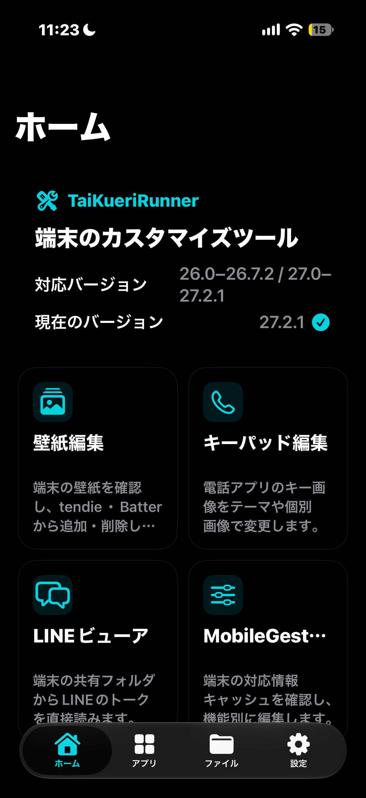
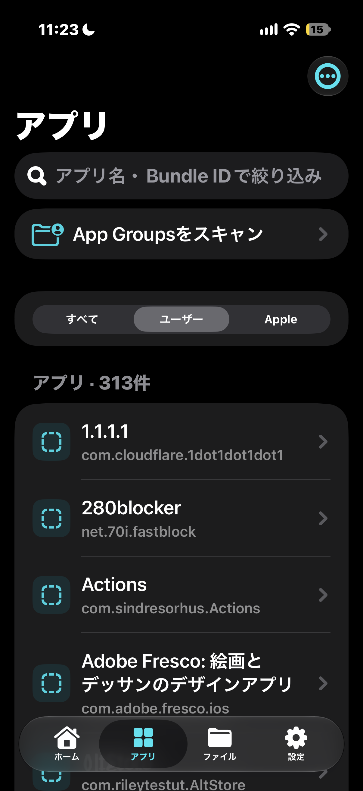

# TaiKueriRunner

[](LICENSE)
[](#build-and-test)
[](Package.swift)

[English](README.md) | **日本語**

[`worse_query`](https://github.com/forcequitOS/worse_query)を利用した、使いやすい多機能ユーティリティです。iPhone / iPad、iOS 26.0以降を対象としています。

> [!WARNING]
> private APIを利用するアプリです。脱獄ではありません。MobileGestalt・壁紙・キーパッドの変更を行うと不具合につながる場合があります。実機で試す際はバックアップなどの安全対策をした上で自己責任でお試しください。



端末の言語設定に合わせて、日本語または英語で表示されます。

## 対応バージョン
iOS 26.0~26.7.2,27.0.0~27.2.1(27.3b2)

## 機能
現在実装している機能は下記の通りです。
- アニメーション壁紙の追加(.tendies,.batter)
- 電話のキーパッド画像の変更(.passthm)
- MobileGestaltの変更
- LINE専用ビューワー
- アプリ,App Groupの閲覧
- 各種ファイルの閲覧(sqlite,plistには専用ビューワーを用意済み)

## インストール方法
Github Releaseにある`TaiKueriRunner.ipa`をダウンロードして任意のサイドローディング用のアプリ(ex:AltStore Classic)などを用いてインストールしてください。

## 機能詳細

### アニメーション壁紙
任意の壁紙用のファイルを追加することで、壁紙ストアに追加することができます。
また、現在インストール済みの壁紙一覧の表示などができます。
### 電話キーパッドの変更
現在の電話のキーパッドの置換、保存、ファイルからの一括置換が行えます。
### MobileGestalt編集
MGkeys側で確認できるほぼすべてのKeyに対して編集を行うことができます。
これらは機械的に生成されたものに対してAIを用いて説明書きをつけただけのため、正常に動く部分もあれば、動かない部分もあると思います、ご了承ください。
### LINE Viewer
過去の全トーク履歴の閲覧、端末内にキャッシュとして残っている画像/ファイルの閲覧や保存ができます。
LINE側で期限切れとなっていても残っている場合があるのでぜひご活用ください。

### リスプリング

[neospring](https://github.com/rooootdev/neospring)の方式を移植した機能です。「設定」または各編集画面の管理から実行でき、試行上限は8秒固定です。実行前に作業を保存してください。

## 開発者向け

Swift 6言語モード、iOS 26以降を前提にしています。

実機向けReleaseのデバイス署名なしビルドと再署名用IPA作成は、次のスクリプトで実行できます。

```sh
./build-unsigned.sh
```

- IPA: `build/TaiKueriRunner-unsigned.ipa`
- App: `build/Build/Products/Release-iphoneos/TaiKueriRunner.app`
- ログ: `build/unsigned-build.log`

署名なしビルド:

```sh
xcodebuild -project TaiKueriRunner.xcodeproj -scheme TaiKueriRunner \
  -configuration Release -sdk iphoneos \
  -destination 'generic/platform=iOS' \
  -derivedDataPath build CODE_SIGNING_ALLOWED=NO build
```

## ライセンス・クレジット

GPL-3.0-or-later。詳細は[THIRD_PARTY.md](THIRD_PARTY.md)、全文は[LICENSE](LICENSE)、SPDX識別子と著作権表示は[NOTICE](NOTICE)を参照してください。

- [forcequitOS/worse_query](https://github.com/forcequitOS/worse_query) — 脆弱性を発見して公開してくれた方
- [rooootdev/neospring](https://github.com/rooootdev/neospring) — リスプリング方式の移植元。
- [kolbicz/WQFiles](https://github.com/kolbicz/WQFiles) — アプリを作る際に参考にさせていただいた方。
- [PoomSmart/MGKeys](https://github.com/PoomSmart/MGKeys) — MobileGestaltの対応表を公開している方。
