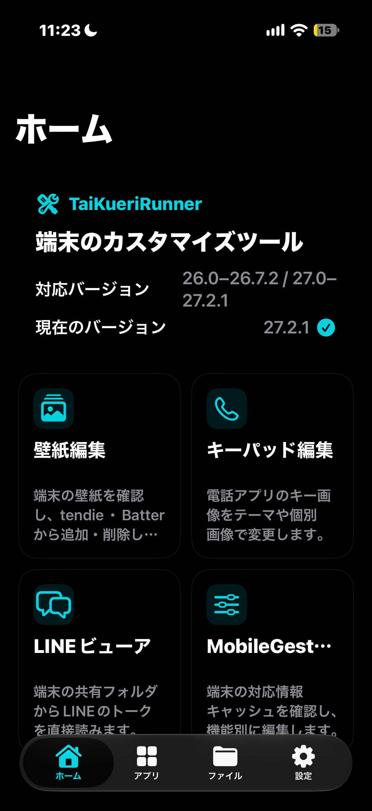
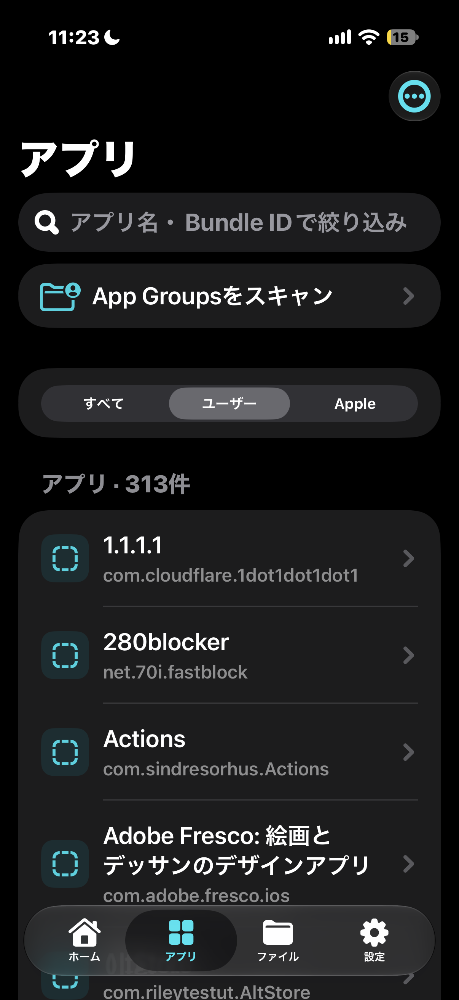

# TaiKueriRunner

[](LICENSE)
[](#for-developers)
[](Package.swift)

**English** | [日本語](README.ja.md)

An easy-to-use, multi-purpose utility built on [`worse_query`](https://github.com/forcequitOS/worse_query). It targets iPhone / iPad and iOS 26.0 or later.

> [!WARNING]
> This app uses private APIs. It is not a jailbreak. Changing MobileGestalt, wallpapers, or keypad images can cause problems. If you try it on a real device, take precautions such as making a backup and proceed at your own risk.



The app follows the device language and is localized in Japanese and English.

## Supported versions

iOS 26.0–26.7.2, 27.0.0–27.2.1 (27.3b2)

## Features

Currently implemented features:

- Add animated wallpapers (`.tendies`, `.batter`)
- Change Phone keypad images (`.passthm`)
- Modify MobileGestalt
- Dedicated LINE viewer
- Browse apps and App Groups
- View various files (dedicated viewers are available for SQLite and plist)

## Installation

Download `TaiKueriRunner.ipa` from GitHub Releases and install it with any sideloading app (e.g., AltStore Classic).

## Feature details

### Animated wallpapers

You can add any wallpaper file to the wallpaper store and display a list of currently installed wallpapers.

### Phone keypad changes

You can replace the current Phone keypad, save it, and replace images in bulk from files.

### MobileGestalt editing

You can edit almost every key that can be confirmed in MGKeys. These definitions were generated mechanically and then given AI-written descriptions, so some may work correctly while others may not. Please understand this in advance.

### LINE Viewer

You can browse the entire past chat history and view or save images and files cached on the device. Data that has expired on LINE's side may still remain, so please make use of it.

### Respring

This feature ports the approach from [neospring](https://github.com/rooootdev/neospring). It can be triggered from Settings or the management section of each editor, with a fixed attempt limit of eight seconds. Save your work before running it.

## For developers

The project requires Swift 6 language mode and iOS 26 or later.

You can build a release for a real device without device signing and create a re-signable IPA with the following script:

```sh
./build-unsigned.sh
```

- IPA: `build/TaiKueriRunner-unsigned.ipa`
- App: `build/Build/Products/Release-iphoneos/TaiKueriRunner.app`
- Log: `build/unsigned-build.log`

Unsigned build:

```sh
xcodebuild -project TaiKueriRunner.xcodeproj -scheme TaiKueriRunner \
  -configuration Release -sdk iphoneos \
  -destination 'generic/platform=iOS' \
  -derivedDataPath build CODE_SIGNING_ALLOWED=NO build
```

## License and credits

GPL-3.0-or-later. See [THIRD_PARTY.md](THIRD_PARTY.md) for details, [LICENSE](LICENSE) for the full text, and [NOTICE](NOTICE) for the SPDX identifier and copyright notice.

- [forcequitOS/worse_query](https://github.com/forcequitOS/worse_query) — the person who discovered and published the vulnerability
- [rooootdev/neospring](https://github.com/rooootdev/neospring) — source of the ported respring approach
- [kolbicz/WQFiles](https://github.com/kolbicz/WQFiles) — reference used when building this app
- [PoomSmart/MGKeys](https://github.com/PoomSmart/MGKeys) — publisher of the MobileGestalt mapping table
